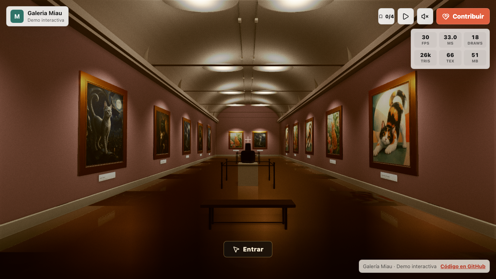

# Galería Miau

[](https://github.com/Gonic0/galeria-miau/actions/workflows/ci.yml)

Galería de arte 3D para recorrer desde el navegador, con three.js, WebGPU y fallback a WebGL2.

*An interactive 3D art gallery built with three.js, WebGPU and a WebGL2 fallback.*

[**Probar la demo**](https://galeria-miau.vercel.app/) · [Reportar un error](https://github.com/Gonic0/galeria-miau/issues) · [Proponer una mejora](https://github.com/Gonic0/galeria-miau/issues/new)



## Estado del proyecto

Es una **demo técnica**, con cuatro obras únicas distribuidas en quince posiciones. No recibe donaciones ni procesa pagos. Los botones de colaboración y el enlace del pie llevan a este repositorio; no hay patrocinadores comerciales asociados a la demo.

La licencia del código y las condiciones de reutilización de las imágenes están pendientes de definición.

## Qué puedes probar

- Recorrido libre con teclado y mouse, o controles táctiles en móvil.
- Recorrido guiado, vista ampliada de cada obra y enlaces para compartirla.
- Progreso de visita guardado en el navegador.
- Audio ambiental sintético que puedes activar desde la sala.
- Renderizado con WebGPU cuando está disponible y fallback a WebGL2.

## Ejecutar en local

Necesitas **Node.js 24** y **pnpm 10.33.0**, la versión fijada en `package.json`.

```bash
pnpm install --frozen-lockfile
pnpm dev
```

Abre `http://localhost:5173`. El navegador necesita WebGPU o WebGL2 y aceleración gráfica habilitada. No se requieren cuentas, claves ni variables de entorno para explorar la galería.

## Comprobaciones automáticas

El workflow [CI](https://github.com/Gonic0/galeria-miau/actions/workflows/ci.yml) se ejecuta en cada PR y en los cambios de `main`. Instala las dependencias fijadas, compila la aplicación y prueba la versión de producción en escritorio y móvil.

La prueba de navegador comprueba que la sala se renderiza, carga obras, permite moverse y muestra una invitación a colaborar sin pagos ni enlaces de ejemplo. También detecta errores de consola y respuestas HTTP fallidas del sitio. Guarda capturas y un informe en `test-results/`, disponibles como artefactos de la ejecución durante siete días.

Para repetirla en local:

```bash
pnpm exec playwright install chromium
pnpm build
pnpm preview
```

Con la vista previa abierta, en otra terminal:

```bash
GALLERY_URL=http://127.0.0.1:4173/ pnpm verify
```

La prueba usa Chromium para verificar el **fallback WebGL2**, permitiendo renderizado por software cuando no hay una GPU disponible. Comprueba también que los cuadros contienen detalle visible, para detectar una sala con marcos vacíos. No mide rendimiento ni valida WebGPU nativo; esos casos necesitan una revisión en el navegador y equipo correspondientes.

## Cómo colaborar

Para reportar un error, incluye el navegador y su versión, sistema operativo, pasos para reproducirlo y lo que esperabas ver. Si el problema es visual, añade una captura y señala si ocurre con WebGPU o WebGL2 cuando puedas comprobarlo.

Para proponer un cambio, abre primero un issue si afecta al recorrido, al catálogo o al diseño de la sala. Las mejoras pequeñas pueden ir directamente en una PR con su propósito y las comprobaciones realizadas.

Áreas en las que colaborar:

- Accesibilidad del recorrido, navegación por teclado y movimiento reducido.
- Compatibilidad del renderizado entre navegadores.
- Compresión de texturas y mediciones de rendimiento reproducibles.

## Stack y estructura

- **three.js 0.184**: `WebGPURenderer` y postprocesado con TSL.
- **Vite 8**: desarrollo y compilación con separación de dependencias.
- **lucide**: iconos de la interfaz.
- **WebAudio**: ambiente, pasos y maullidos sintetizados.
- **Playwright**: comprobaciones del recorrido en escritorio y móvil.

```text
public/artworks/              Imágenes de las obras
src/main.js                  Escena, renderizado e interacción
src/styles.css               Interfaz y diseño adaptable
src/gallery/catalog.js       Obras, posiciones y enlaces del proyecto
src/gallery/audio.js         Audio sintético
scripts/verify-gallery.mjs   Comprobación de navegador
.github/workflows/ci.yml     Compilación y pruebas automáticas
```

Para añadir una obra, guarda su imagen en `public/artworks/` y añádela a `temporaryPhotos` en `src/gallery/catalog.js`, con título, autor, año y descripción. `artworkSlots` define dónde se muestran las obras. Conserva los créditos y documenta las condiciones de uso de las imágenes que propongas.

```bash
pnpm compress-textures       # Convierte PNG a WebP con sharp
```

## Publicar una copia

El proyecto incluye `vercel.json` para compilar con `pnpm build` y servir `dist/`. Puedes importar el repositorio en Vercel o publicar ese directorio con un proveedor de alojamiento estático.

Los enlaces de colaboración se definen en `galleryConfig.donation` y `sponsors`, dentro de `src/gallery/catalog.js`. Si publicas una copia, actualiza también los enlaces del README y conserva una descripción clara del estado de la demo.
